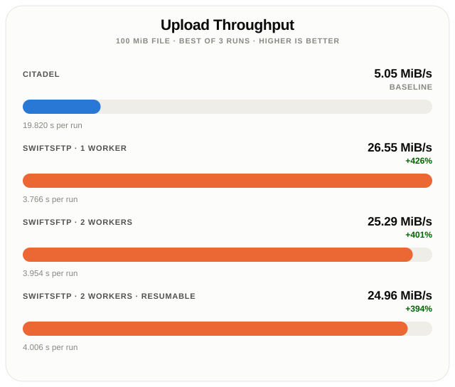
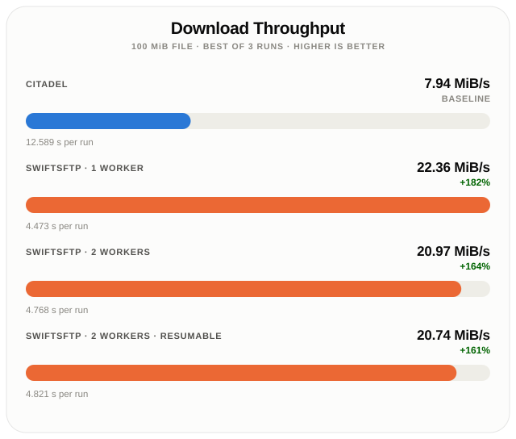

# SwiftSFTP

[](LICENSE)

[](Package.swift)
[](Package.swift)
[](Package.swift)
[](Package.swift)
[](Package.swift)
[](Scripts/LinuxBuild/build.sh)
[](Scripts/AndroidBuild/build.sh)

[](https://swift.org/package-manager/)
[](https://github.com/RuiNelson/SwiftSFTP/releases)
[](https://github.com/RuiNelson/SwiftSFTP/actions/workflows/apple.yml)
[](https://github.com/RuiNelson/SwiftSFTP/actions/workflows/linux.yml)
[](https://github.com/RuiNelson/SwiftSFTP/actions/workflows/android.yml)


SwiftSFTP is a modern, ergonomic Swift Package Manager library that wraps `libssh2` and `OpenSSL`. It provides a high-level `async/await` API for seamless SFTP file transfers and SSH-based interactions, while also exposing the underlying C APIs for advanced use cases.

Whether you need to quickly upload files, manage a remote filesystem, or build anything on top of SSH, SwiftSFTP offers a robust and asynchronous interface built on industry-standard libraries.

**Features:**

- **Ergonomic API**: High-level abstractions over SFTP and SSH functionalities using modern Swift concurrency (`async/await`).
- **Solid Base**: Built on top of `libssh2` and OpenSSL, compiled from pinned C sources by SwiftPM on every supported platform.
- **Fast**: Outperforms other Swift SFTP clients — 5.3× upload and 2.8× download over one connection, keeping up to 2 MiB in flight per connection; `multiUpload` / `multiDownload` add connections when a link has headroom; see [Benchmarks](#benchmarks).
- **Resumable Transfers**: `upload` / `download` and `multiUpload` / `multiDownload` can continue interrupted transfers; see [Uploading and Downloading](Documentation/UserGuide.md#uploading-and-downloading) and [Resumable parallel transfers](Documentation/UserGuide.md#resumable-parallel-transfers).
- **Shell Agent**: Server-side copy, move, concatenation, hash, archive, download and related work over a persistent shell on the same session, without hauling the payload over the network; see [Shell Agent](Documentation/UserGuide.md#shell-agent-server-side-operations).
- **AVFoundation Playback**: The optional `SwiftSFTPAVFoundation` product streams remote media into `AVPlayer` over one or several connections, with seeking, parallel striped reads and read-ahead; see [AVFoundation Playback](#avfoundation-playback).
- **Cryptographic Utilities**: OpenSSL helpers to validate user keys and `known_hosts` host keys, plus key generation and conversion for Ed25519, Ed448, ECDSA, RSA, ML-DSA and SLH-DSA; see [Cryptographic Utilities](Documentation/CryptographicUtils.md).
- **Low-Level Access**: Fully exposed `libssh2` wrappers (Layer 0), allowing users to expand functionality or perform other non-SFTP related SSH tasks.

## Cookbook

Here is a quick-start example showing how to connect, navigate, and upload files using SwiftSFTP:

```swift
import SwiftSFTP
import Foundation

// - Instantiate an SFTP client
let myClient = try SFTPClient(
    openSocketIn: .init(hostname: "localhost", port: 6922),
    hostKeyAcceptance: .acceptAny, // Configurable for strict host key checking
    authentication: .init(name: "bulbasaur", auth: .password("pass123")), // Also supports .privateKey
    compressionPreference: (clientToServer: [.zlib], serverToClient: [.zlib])
)

// - Call this to connect
try await myClient.login()

// - Check server banner
let banner = try await myClient.banner
print(banner)

// - Get the home directory
let home = try await myClient.currentWorkingDirectory
print(home)

// - List a directory
let contents = try await myClient.listDirectory(path: "./Fixtures")

// - Open a file handle
if let largestFile = contents.bySize.last {
    let myFileHandle = try await myClient.openFile([.read], path: largestFile.fullPath)

    // Read first bytes
    let firstBytes = try await myFileHandle.read(upTo: 1024)
    
    // Seek
    myFileHandle.offset = 2048
    // ...
    try await myFileHandle.close()
}

// - Upload a file with progress tracking
let localFile = URL(fileURLWithPath: "myfile.zip")
try await myClient.upload(from: localFile, to: "/home/bulbasaur/myfolder/myfile.zip") 
    { doneBytes, totalBytes, lastBlockBytes, lastBlockTime in
        // Return true/false to continue/terminate the upload

        let progress = ((Double(doneBytes) / Double(totalBytes)) * 100).rounded()
        let speed = (Double(lastBlockBytes) / Double(lastBlockTime)).rounded()

        print("Completed \(progress)% at \(speed) B/s")

        return true
    }

// - Delete a file or directory with everything in it (less radical methods available)
try await myClient.delete(path: "myfolder")

// - Close the connection
try await myClient.close()
```

The example requests zlib compression in both directions, with automatic fallback to `.none` if the server does not
support it. Check `myClient.compression` after login for the negotiated algorithms.

For complete details, see:

- [User's Guide](Documentation/UserGuide.md) — connections, transfers, and filesystem operations:
  - [Connecting to a Server](Documentation/UserGuide.md#connecting-to-a-server)
  - [Authentication](Documentation/UserGuide.md#authentication)
  - [Host Key Verification](Documentation/UserGuide.md#host-key-verification)
  - [Navigating the Remote Filesystem](Documentation/UserGuide.md#navigating-the-remote-filesystem)
  - [Working with Files](Documentation/UserGuide.md#working-with-files)
  - [Uploading and Downloading](Documentation/UserGuide.md#uploading-and-downloading)
  - [Copying, Renaming, and Deleting](Documentation/UserGuide.md#copying-renaming-and-deleting)
  - [Shell Agent](Documentation/UserGuide.md#shell-agent-server-side-operations)
  - [Symlinks](Documentation/UserGuide.md#symlinks)
  - [Filesystem Statistics](Documentation/UserGuide.md#filesystem-statistics)
  - [Keeping the Connection Alive](Documentation/UserGuide.md#keeping-the-connection-alive)
  - [Validating SSH Keys](Documentation/UserGuide.md#validating-ssh-keys-offline)
  - [Error Handling](Documentation/UserGuide.md#error-handling)

- [Cryptographic Utilities](Documentation/CryptographicUtils.md) — offline validation and key management:
  - [User Authentication Key Validation](Documentation/CryptographicUtils.md#user-authentication-key-validation-keyvalidation)
  - [Host Key Validation](Documentation/CryptographicUtils.md#host-key-validation-known_hosts)
  - [Asymmetric Key Generation, Import, and Export](Documentation/CryptographicUtils.md#asymmetric-keys-asymmetriccryptography)

## AVFoundation Playback

Add the `SwiftSFTPAVFoundation` product to play remote audio or video on macOS, iOS, tvOS, visionOS, and Mac Catalyst:

```swift
import AVFoundation
import SwiftSFTP
import SwiftSFTPAVFoundation

// Use authenticated clients and keep them open throughout playback. Each fork is another connection,
// and the connections read different stripes of the file at the same time.
let clients = [client, try await client.fork(), try await client.fork(), try await client.fork()]
let item = clients.makePlayerItem(at: "/Videos/holiday.mp4")
let player = AVPlayer(playerItem: item)
player.play()

// A single connection works too. Use an asset for metadata, asset options, or custom AVFoundation workflows:
let asset = client.makeAsset(at: "/Videos/holiday.mp4")
```

Each client opens the file read-only when AVFoundation loads it. The clients fetch 2 MiB stripes in parallel and read
8 MiB ahead of playback; pass `stripeSize:` and `readAheadSize:` to change either. Playback and seeking never create a
local copy. Releasing an asset or its player item cancels its pending reads and closes its file handles. The caller
still owns and closes the SFTP clients. The media type is inferred from the filename; pass `contentType: .mpeg4Movie`
for an extensionless MP4. The adapter is unavailable on watchOS, Linux, and Android.
See the [User's Guide](Documentation/UserGuide.md#avfoundation-playback) for read-ahead, lifetime, and error handling
details.

The [sample app](SampleApp/README.md) includes a SwiftUI player for macOS, iOS, and visionOS, using this checkout's
local package. Open `SampleApp/SFTP+AV/MediaPlayerOverSFTP.xcodeproj` in Xcode to run it.

## Adding SwiftSFTP to your Project

### Swift Package Manager

Add the following dependency to your `Package.swift` file:

```swift
dependencies: [
    .package(url: "https://github.com/RuiNelson/SwiftSFTP.git", from: "3.0.0")
]
```

Then, add `SwiftSFTP` to the dependencies of your target:

```swift
targets: [
    .target(
        name: "YourTargetName",
        dependencies: [
            .product(name: "SwiftSFTP", package: "SwiftSFTP"),
        ]
    )
]
```

For AVFoundation playback, use `.product(name: "SwiftSFTPAVFoundation", package: "SwiftSFTP")` as your target's
dependency. This product supplies both the `SwiftSFTP` and `SwiftSFTPAVFoundation` modules in one dynamic library.

### Xcode

If you are using Xcode, you can directly add this repository as a Swift Package dependency in your project settings:

1. Navigate to **File > Add Package Dependencies...**
2. Enter the repository URL: `https://github.com/RuiNelson/SwiftSFTP.git`
3. Choose the version rule you prefer (e.g., "Up to Next Major Version") and click **Add Package**.
4. Make sure the `SwiftSFTP` product is added to your app target.

For AVFoundation playback, select `SwiftSFTPAVFoundation` as the product; it includes the `SwiftSFTP` module too.

### Source distribution

SwiftSFTP includes no precompiled libraries or XCFrameworks. SwiftPM builds libssh2
and the prepared OpenSSL C sources for the destination platform and architecture.
Consumers need neither system OpenSSL nor Perl/Make, build plugins, or an SDK signing
certificate. Xcode signs the built product as part of the application's normal signing.
The first build compiles OpenSSL; subsequent builds are incremental.

Libssh2 is built with SSH zlib compression support and links the platform's `libz`.
Apple SDKs and the Android NDK provide it; Linux builds require the zlib development
package (for example, `sudo apt-get install zlib1g-dev` on Debian/Ubuntu).
Compression is disabled by default per session. Configure it with `compressionPreference` when creating an
`SFTPClient`; see [SSH compression](Documentation/UserGuide.md#ssh-compression). Layer 0 callers can enable it with
`SessionFlag(session: session, flag: .compress, value: true)` before the SSH handshake.

OpenSSL preparation and its generated sources are maintained in
[SwiftSFTP-OpenSSL](https://github.com/RuiNelson/SwiftSFTP-OpenSSL), included here as
`Vendor/SwiftSFTP-OpenSSL`. SwiftPM fetches the nested submodules automatically;
use `git clone --recurse-submodules` when checking out this repository manually.

The package includes a privacy manifest for the SDK's file metadata access. Applications
remain responsible for their own data practices and privacy declarations.
See [OpenSSL source maintenance](Documentation/OpenSSLSourceBuild.md) for the pinned
configuration, updating instructions, and the portable C performance tradeoff.

### Crypto coexistence

The `SwiftSFTP` product remains dynamically linked. Its OpenSSL public symbols use
SDK-private linker names, and its internal symbols are hidden, so another SDK's crypto
implementation cannot replace the calls inside SwiftSFTP. The OpenSSL headers use a
private package namespace rather than the
canonical `openssl/` include tree. Xcode embeds the SwiftSFTP framework for normal
SwiftPM product dependencies; there are no separate OpenSSL frameworks to embed.
See [packaging regression tests](Tests/Packaging/README.md) for a standalone
consumer test and the optional official MEGA artifact check.

## Benchmarks

On a Wi-Fi network, SwiftSFTP uploaded a 100 MiB file 5.3× faster and downloaded it 2.8× faster than
[Citadel 0.12.1](https://github.com/orlandos-nl/Citadel), another Swift SFTP library, over a single
connection. Much of that gap comes from how the two clients use the connection: SwiftSFTP keeps up to
2 MiB of data in flight per connection, while Citadel waits for each request to be answered before
sending the next. The numbers below show the difference; the rest of the section explains when it
matters — and when adding connections does not help.

<p>
  
  
</p>

### How the test was run

The [`Benchmark`](Benchmark) executable transferred a 100 MiB file of random data between a Mac and an
SFTP server on the same Wi-Fi network (client ↔ access point ↔ server). Both libraries used the same
server, credentials, file, and network, and each was driven through its public API, with the exact
buffer sizes and options in the benchmark source. Every configuration ran three times; the fastest run
is reported, so an unrelated Wi-Fi hiccup is less likely to decide the result. Each transfer was
verified to have the expected 100 MiB size.

SwiftSFTP used its default 2 MiB read-ahead and write-ahead windows and was built with the portable
OpenSSL configuration SwiftPM produces (see [Source distribution](#source-distribution)). Random data
keeps compression from affecting the result.

### Results

The charts use the API's term, **worker**, for one parallel transfer; each worker normally uses its own
connection. The one-connection bars use plain `upload` / `download`; the two-worker bars use
`multiUpload` / `multiDownload`. The time under each bar is for the full 100 MiB file.

Over one connection, SwiftSFTP uploads 5.3× and downloads 2.8× as fast as Citadel. Two workers were
slightly slower than one on this link, and resumability cost about 1%. The charts express improvement as
a percentage increase over Citadel; +426% is the same as 5.3× faster.

### Why one connection is faster

A **round trip** is the time between sending a request and receiving its reply. A client that sends one
request at a time can move roughly one request's worth of data per round trip. Send 512 KiB per round
trip over a link with 20 ms round trips and you get about 25 MiB/s, even if the link could carry much
more: the connection sits idle while each reply is in transit. Larger requests help, but only up to the
server's limits and SSH's flow-control window. Citadel's 0.12.1 upload path also splits each write into
32,000-byte requests, so it makes more round trips than its download path does; that helps explain why
the upload gap is larger than the download gap.

SwiftSFTP keeps a window of requests in flight instead:

- [`writeAhead`](Documentation/UserGuide.md#write-ahead) (2 MiB by default) sends write requests before
  earlier writes are acknowledged.
- [`readAhead`](Documentation/UserGuide.md#read-ahead) (2 MiB by default) requests bytes ahead of the
  position being read.

The server works on later requests while earlier replies travel back, so the round trip carries data
instead of leaving the link empty. The 2 MiB default is about what
[OpenSSH's `sftp`](https://man.openbsd.org/sftp.1) keeps outstanding (64 requests of up to 32 KiB).
Pipelining does not make the link itself faster; it keeps the link busy. On a short, fast connection the
gain is small. Over Wi-Fi or a long-distance link it can be the difference between a few MiB/s and tens
of MiB/s.

### When more connections help

`multiUpload` and `multiDownload` split a file across workers, each an independent connection with its
own in-flight window and TCP congestion window. One connection's throughput is capped by its window:

    throughput ≈ window size ÷ round-trip time

At the 2 MiB default, one connection cannot exceed about 67 MiB/s on a 30 ms link or 20 MiB/s on a
100 ms link, however much bandwidth the link offers. The actual rate is the lower of that window limit
and the link's own capacity. Workers add windows, so they help when round trips are long, when a server
limits a single session, or when the link has more bandwidth than one window can keep busy.

On this Wi-Fi network, the link, not the 2 MiB window, was the limit, so a second connection had little
to add. It shared the same radio and added handshake and coordination work, and the transfer finished
4.7% slower on upload and 6.2% slower on download. That is a result for this link, not a rule: on a
high-latency or per-session-limited link, extra workers can be substantially faster. The right count is
worth measuring rather than assuming.

### What resumability costs

A resumable multi-transfer appends a small trailer past the payload, recording which blocks have
arrived, so a later call can skip the completed parts. The trailer is removed before the file is put in
place. Compared with the non-resumable two-worker runs, that bookkeeping cost 1.3% on upload and 1.1% on
download. A resumable upload opens one extra connection for its trailer; a resumable download writes its
trailer locally and uses no extra connection. You pay this cost only when you ask
`multiUpload` / `multiDownload` to be resumable.

### Measure your own link

The best worker count depends on the network, so `multiTune` measures it: it transfers a test file at
increasing parallelism and returns the count with the highest throughput. On a link that one connection
already saturates, it reports 1. The [`Benchmark`](Benchmark) package builds the harness used above and
ships it as the `swift-sftp-benchmark` and `swift-sftp-multitune` executables:

```sh
swift build --package-path Benchmark -c release
swift run --package-path Benchmark -c release swift-sftp-benchmark --help
swift run --package-path Benchmark -c release swift-sftp-multitune --help
```

Use release builds for throughput measurements. See
[Choosing a worker count](Documentation/UserGuide.md#choosing-a-worker-count) for the `multiTune` API and
[the Benchmark README](Benchmark/README.md) for server setup and options.

These figures describe one Wi-Fi network, one server, and one moment in October 2026. Interference,
round-trip time, server disk speed, SSH cipher, and other traffic all move them, so treat them as a
demonstration of the mechanism rather than a promise for your deployment.

## License

SwiftSFTP is available under the [Apache License 2.0](LICENSE).

### Third-party licenses

SwiftSFTP depends on the following libraries. Their licenses apply when you use or redistribute SwiftSFTP, including its prepared OpenSSL sources.

| Component | Role | License | Source |
| --- | --- | --- | --- |
| **SwiftSFTP** | This package | [Apache License 2.0](LICENSE) | [LICENSE](LICENSE) |
| **libssh2** | SSH/SFTP protocol (vendored C sources) | [BSD-3-Clause](Vendor/libssh2/COPYING) | [Vendor/libssh2/COPYING](Vendor/libssh2/COPYING) |
| **OpenSSL** | Cryptography (pinned source snapshot, compiled by SwiftPM) | [Apache License 2.0](https://github.com/RuiNelson/SwiftSFTP-OpenSSL/blob/main/Sources/OpenSSLCrypto/LICENSE.txt) | [SwiftSFTP-OpenSSL](https://github.com/RuiNelson/SwiftSFTP-OpenSSL) |
| **PathWorks** | Path utilities (SwiftPM dependency) | [MIT](https://github.com/RuiNelson/PathWorks/blob/main/LICENSE) | [PathWorks](https://github.com/RuiNelson/PathWorks) |
| **swift-log** | Logging (SwiftPM dependency) | [Apache License 2.0](https://github.com/apple/swift-log/blob/main/LICENSE.txt) | [apple/swift-log](https://github.com/apple/swift-log) |

### Use in commercial closed-source software

All of the licenses above are **permissive**. They allow use of SwiftSFTP and its dependencies in proprietary, commercial, closed-source applications (including apps distributed through the App Store and other app stores), **without requiring you to open-source your own code**.

In practice, that means you may:

- Link SwiftSFTP (and the bundled libssh2 / OpenSSL) into closed-source products
- Sell or distribute those products without publishing your application source
- Modify SwiftSFTP or its dependencies for your own use (subject to each license’s terms)

You remain responsible for meeting each license’s **attribution and notice** requirements. Typical obligations when you distribute a binary that includes this software:

- **Apache 2.0** (SwiftSFTP, OpenSSL, swift-log): include a copy of the license; retain copyright and attribution notices; if you modify the licensed work, state that you changed it; if a `NOTICE` file is present, include its attribution notices as required by the license
- **BSD-3-Clause** (libssh2): retain the copyright notice, conditions, and disclaimer in source redistributions; reproduce them in documentation and/or other materials provided with binary redistributions; do not use the copyright holders’ names to endorse your product without permission
- **MIT** (PathWorks): include the copyright notice and permission notice in all copies or substantial portions of the software

A common way to satisfy these is an **About**, **Acknowledgments**, or **Open Source Licenses** screen (or a licenses file shipped with the product) that lists the components above and includes the corresponding license texts.

None of these licenses is copyleft (unlike the GPL family): linking against them does not force your application’s source code to be released under an open-source license.

This section is a practical summary, not legal advice. For compliance questions specific to your product or jurisdiction, consult a lawyer and the full license texts linked above.

[](https://swiftpackageindex.com/RuiNelson/SwiftSFTP)
[](https://swiftpackageindex.com/RuiNelson/SwiftSFTP)
